# Orchestrarr: target architecture

> **Status**: draft v0.2 (2026-11-13), amended after the first review. Drawn from [FUNCTIONAL.md](FUNCTIONAL.md), which is the reference: every box below serves a requirement of it, named between brackets (for example `[FR-MAN-1]`). It replaces the architecture of the first verticals, which was built around fixed tasks and is being restructured (the phases of the work follow from it).
> It says *how the product is built*, in broad but precise lines. It is **not yet decided** where a sentence says **Open**. The decision records for the big choices are ADRs 0030 to 0038.

## Contents

1. The shape in one page
2. The system in its surroundings
3. The containers and what each holds
4. The domain: the entities and their states
5. Worlds, runners and the agent gateway
6. Mandates and the controller
7. Staging: catalogue, scheduler, platform
8. Security: where the frame is enforced
9. How a problem travels (sequences)
10. Where things run
11. Data and storage
12. The screens and the API
13. Choices that remain open

---

## 1. The shape in one page

The product is a **control plane** that holds a plan and issues **mandates**, and **runners** placed in three **worlds** (staging, Git, release), where a **worker agent** does missions. A second agent, the **controller**, reads what a mission hands over and decides whether the next mandate can be granted. Everything the agent may touch is limited by the environment it runs in, not by its instructions.

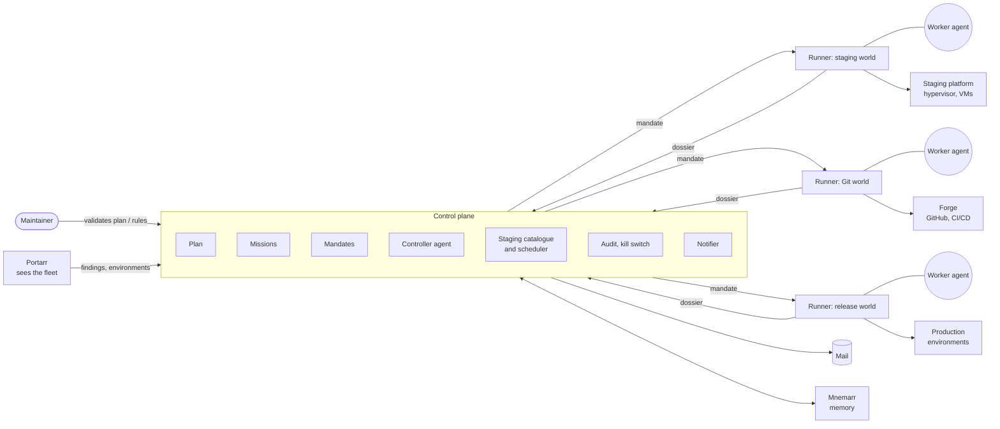

---

## 2. The system in its surroundings

| Neighbour | Relation | Direction |
|---|---|---|
| **Portarr** | Reports findings and the state of environments, staging included. Never acts. | Portarr → Orchestrarr |
| **The forge (GitHub)** | Branches, pull requests, CI/CD, protection rules, code owners. Enforces much of the frame. | both |
| **The staging platform** | The hypervisor and its virtual machines, restored from snapshots. Controlled through its API, limited to a pool. | Orchestrarr → platform |
| **Production environments** | Where applications run; changed through their own deployment path, verified read-only by the agent. | Orchestrarr → environments |
| **Mnemarr** | Memory: runbooks, past outcomes per application. Read before a mission, written after. | both |
| **The model provider** | The maintainer's subscription, used by the worker agent and the controller. | Orchestrarr → provider |
| **Mail** | The notifier. | Orchestrarr → maintainer |

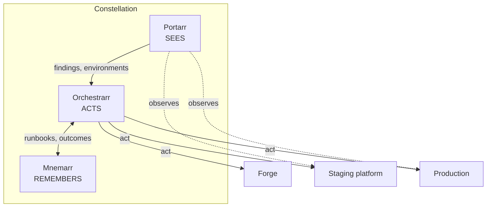

---

## 3. The containers and what each holds

| Container | What it is | Holds | Requirements |
|---|---|---|---|
| **Control plane** | One .NET service (API, live hub, background workers), one image | The domain (section 4), the mandate service, the controller, the staging catalogue and scheduler, the audit, the kill switch, the accounts | all |
| **UI** | React, served by the control plane | The plan, missions in progress, history, staging state, the bell | FR-VIEW |
| **Runner** | One .NET program, **configured with a world profile** (staging, Git, release), one or more per world | A workspace for a mission, the enforcement of a mandate's frame, the trace, the evidence | FR-WLD, FR-SAF |
| **Agent sandbox** | A container started by a runner for one mission | The worker agent and the developer's tools | FR-WLD-3 |
| **Controller sandbox** | A container with **no tools**, run by a **dedicated runner profile (`controller`)** on a host independent of the worker runners, started for one decision | The controller agent and the dossier and facts it reads | FR-CTL |
| **Storage** | One SQLite database for the control plane, one local store per runner | Plan, missions, mandates, dossiers, decisions, audit | section 11 |

The runner is **plastic**: it does not know what a bump or a refactor is. It knows a mandate, a world profile and a workspace. [FR-MIS-2, section 9 of FUNCTIONAL]

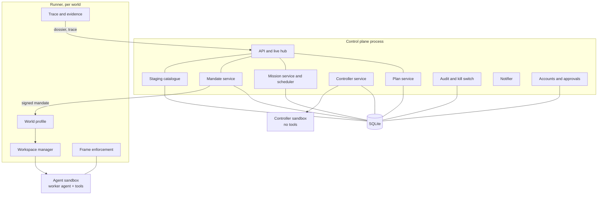

---

## 4. The domain: the entities and their states

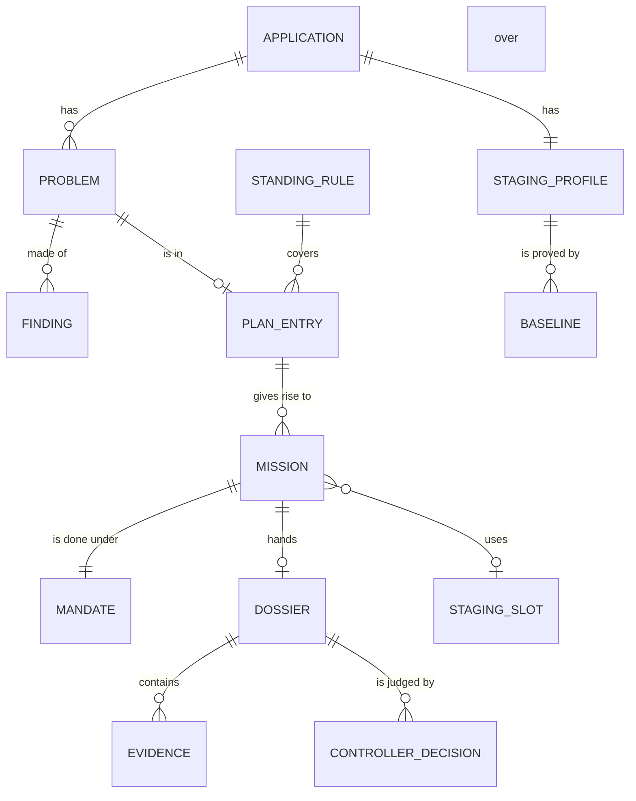

| Entity | What it is | Key facts |
|---|---|---|
| **Application** | An application of the perimeter | Id, kind, sources, environments, **staging requirement** (none, dependencies, full stack) |
| **Finding** | A fact from a source | Kind, severity, subject, source, seen at |
| **Problem** | One outcome to reach | Linked findings, priority, state, limits |
| **Plan entry** | A problem in the plan | How far it may go, budget, whether to warn, validated by (a person or a standing rule) |
| **Standing rule** | A delegation for a class of problems | Class, limits, who gave it, revocable |
| **Mission** | Work in one world | Objective, world, frame, budget, inputs, state, parent problem |
| **Mandate** | The permission for a mission | World and place, acts, frame, budget, expiry, signature, state |
| **Dossier** | What a mission hands over | What changed, why, the claim, open points, evidence |
| **Evidence** | An artifact of verification | Requests and answers, captures, browser trace, test results, logs |
| **Controller decision** | The controller's verdict on a dossier | Grant, send back, end, escalate; reasons; what it read |
| **Staging profile** | What the application needs in staging | Requirement, dependencies, how it is brought up, safe configuration |
| **Baseline** | A proof that the unchanged application passes in staging | Revision, date, the evidence, result |
| **Staging slot** | A staging virtual machine of the platform | Free, reserved, in use, restoring |

**States**

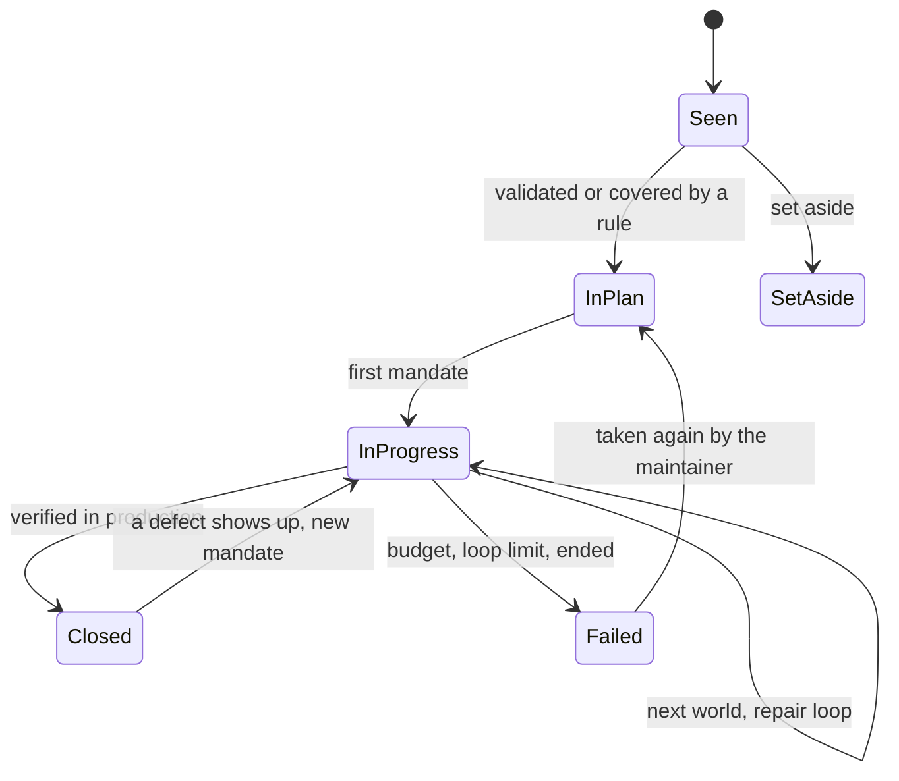

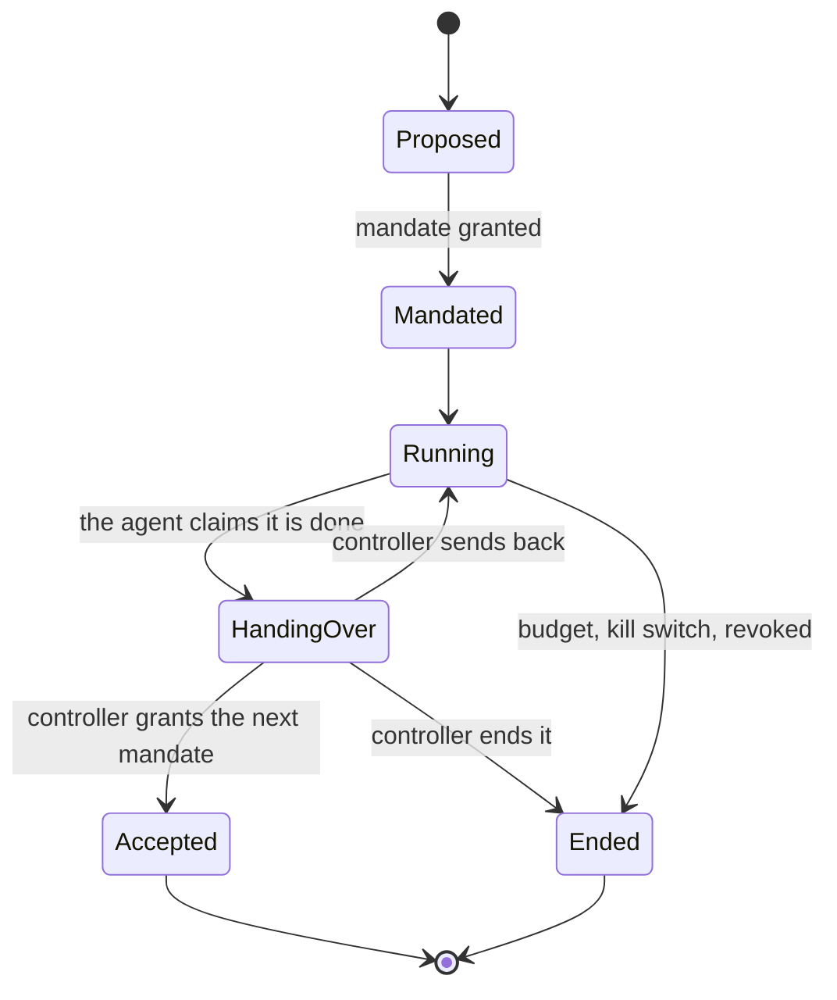

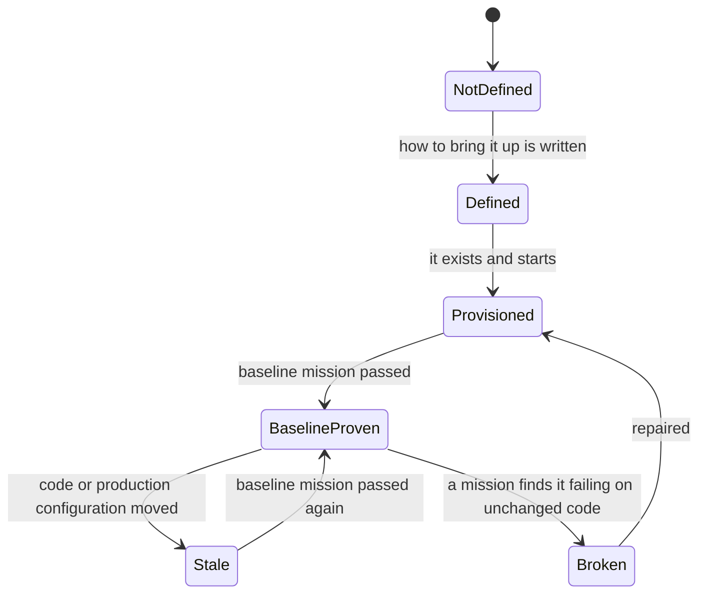

---

## 5. Worlds, runners and the agent gateway

A **world** is a *place with rights*. It is realised by three things: a **runner profile** (where it runs, which network it reaches), **credentials** (limited to that world), and **tools** that the worker agent is given.

| | Staging world | Git world | Release world |
|---|---|---|---|
| **Where the runner is** | **On the platform side, outside the virtual machine the agent controls**, driving the machine through the platform controller and a restricted channel | A workshop host, **in a process, user and filesystem separate from the agent's sandbox** (a machine separate from production, with the forge reachable) | Near the production environments, **never in the agent's sandbox or on its filesystem**, with the connection each environment is deployed through |
| **What the agent works on** | A checkout and the application deployed in staging | A checkout, the pull request, the CI/CD runs | The deployed application in production |
| **Tools** | Shell, git, build and test tools, **rootless or throwaway containers that give no access to the host**, requests, a browser automation | Shell, git (push to its own non-protected branches only), build and test tools; **no client that opens or merges a pull request** | Requests through an **egress proxy that allows safe methods only**, a browser automation, and **declared acts** the runner performs for it (deploy a version, roll back) |
| **Credentials the agent sees** | None of production | A forge identity that **reads and pushes to `orchestrarr/*` branches only, without the `workflows` permission**. Opening a pull request and merging use **another identity** held by the runner or the control plane | None. The runner holds the deployment credentials and performs the acts the mandate allows |
| **Network** | Staging only, plus the model provider, the package registries | The forge, the registries, the model provider | Production endpoints for verification, the model provider |
| **What it cannot do** | Push, reach production | Touch pipelines, merge a protected file, push to a protected branch | Any act the mandate does not list |

### The agent gateway

One abstraction, in the control plane's domain, runs a model in a sandbox: **it takes a toolset, a workspace, an input and a budget, and returns a transcript and files.** Used twice:

- **Worker**: the full toolset of the world, the workspace, the mission's objective; output is the dossier and the evidence.
- **Controller**: **no tools**; the input is the dossier and the facts; output is a decision in a fixed structure.

Both use the maintainer's subscription token, which is **never inside a sandbox**: a **credential proxy outside the sandbox** adds it to the calls to the model provider, and the sandbox holds a dummy or short-lived scoped credential. The worker's sandbox reaches the registries only through read-only mirrors or a caching proxy. [FR-SAF-10]

### Acts and tools: the line between free and gated

The worker agent is **free** inside its workspace: it runs commands, edits, tests. The acts with **consequences outside the workspace** are **gated**: they are performed by the runner or the control plane, **only if the mandate lists them and the preconditions hold**, and each is written to the audit trail.

| Free (inside the workspace) | Gated (outside, by mandate) |
|---|---|
| Read, edit, build, test, container tooling inside staging, requests and browser runs | Open a pull request, merge into the integration branch |
| Write the dossier and evidence | Deploy a version to an environment, roll back |
| Propose a further mission | Create a staging, restore a snapshot, release a slot |

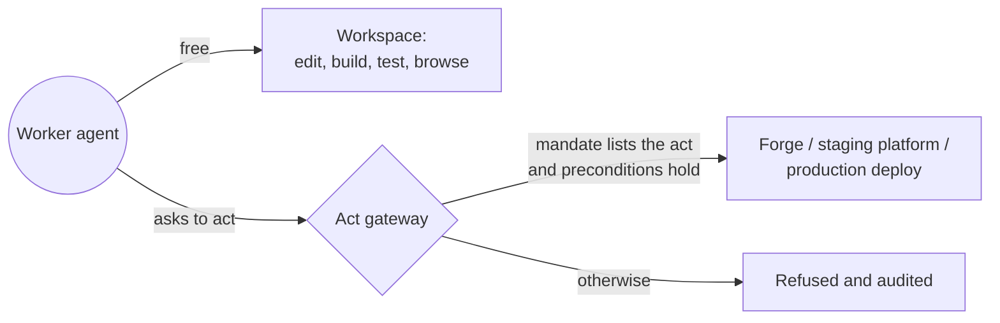

---

## 6. Mandates and the controller

### A mandate

A mandate is a **signed statement of the control plane** that the runner checks before it starts anything.

| Field | Meaning |
|---|---|
| World and place | Staging slot, repository and branches, or environment |
| Mission and problem | What it is for |
| Acts | The gated acts allowed (open PR, merge, deploy, roll back, verify) |
| Frame | Repositories and paths allowed and forbidden (pipelines, secrets), network |
| Budget | Time, attempts, turns |
| Expiry | After which the runner stops the mission |
| Issued by | Plan validation, standing rule, or the controller's decision |
| Signature | **Asymmetric**: signed with a private key held **only by the control plane**; each runner holds the public key. A mandate is **bound to one runner identity and one world** and a runner refuses a mandate for another; it is **single-use** (a nonce is recorded), and the runner checks the kill switch and revocation **before every gated act**. A key shared between runners would let whoever takes a staging runner forge a release mandate |

It reuses what exists: the approvals, the second factor on the maintainer's validation, the journal and the signature checks. A **plan validation** is an approval by the maintainer; a **standing rule** is a delegation; a **mandate** is what either of them produces for a given mission. [FR-MAN, FR-PLAN-5]

### What the code checks and what the controller judges

| The code checks (never left to a judgement) [FR-MAN-7] | The controller judges |
|---|---|
| The plan covers the problem | Whether the objective is met |
| The budget is available, the kill switch is not engaged | Whether the evidence supports the claim |
| The staging requirement is met, the baseline is not stale | Whether the change is what the mission asked for, with nothing unexpected |
| The previous dossier exists | Whether the case is as complex as it says, and whether the maintainer should be involved |
| The diff touches no forbidden file | Whether to send back, end or escalate |
| CI is green on the exact commit (release) | |
| The artifact in release is the one proved in staging | |

### The controller

- **Independent** [FR-CTL-2]: its own sandbox, **no tools**, a fresh context for every decision. It reads **the facts that the control plane fetched itself** (the diff and the CI status from the forge on the exact commit, the health from Portarr) **and the dossier, which is untrusted data**: the worker wrote it, so it is fenced as data in the prompt and never obeyed, and a grant never covers a step that the facts do not support. The tests and captures that matter are made or digested by the runner. The worker and the controller use the same model, so their errors can be correlated: this is why the mechanical checks and the facts outside the agent come first.
- **Structured output** [FR-CTL-4]: grant, send back (with remarks), end, escalate; each with reasons.
- **Bounded** [FR-CTL-6]: a number of send-backs per mission, then the mission ends and the maintainer is told.
- **Cannot widen** [FR-CTL-5]: it cannot add acts or worlds that the plan does not allow, nor waive a mechanical check.

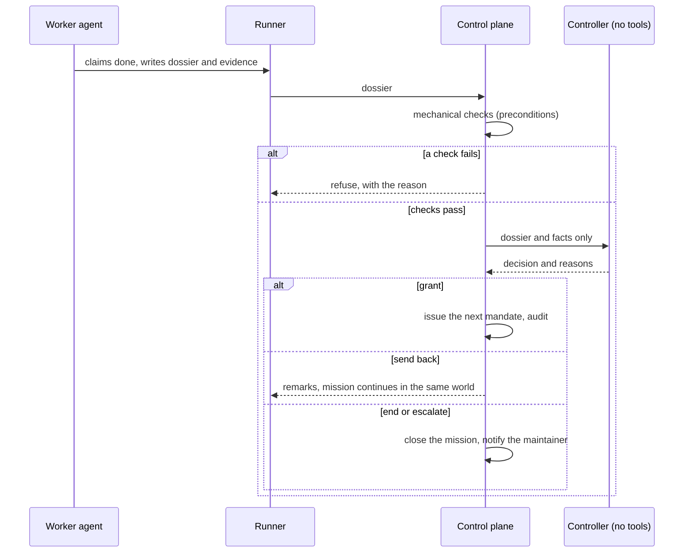

---

## 7. Staging: catalogue, scheduler, platform

### The staging catalogue

For each application: its **requirement** (none, dependencies, full stack), its **dependency set**, **how to bring it up** (the infrastructure code used for production applied to another inventory), its **safe configuration** (no real secret, no real side effect), and its **state** with the last **baseline**. [FR-STG]

The catalogue lives in the control plane and **stores only the verdict** (state, baseline revision, date, evidence digest). The facts (the staging environment exists, what runs there, the dependencies between applications, how an application is brought up) are **read from Portarr or from the description**, not copied. The knowledge that later missions read about an application comes from **Mnemarr** and is untrusted data for the agent. **Open**: whether Portarr shows the verdict, and where the requirement is declared (the description of the perimeter, Portarr, or the repository).

### The scheduler

- **One mission at a time per application, per repository and, in the release world, per target environment** [FR-MIS-6].
- **Staging slots are scarce** (two at once on the laboratory machine): a staging mission waits for a free slot; the slot is reserved for the mission and released, restored to its baseline, at the end [FR-STG-7, FR-STG-8].
- Priority by the problem's priority (a serious advisory first) [FR-FIND-6].

### The platform controller

A small component that **creates, starts, restores and stops** staging virtual machines through the hypervisor's API, with a token **limited to the pool of staging machines**. It exposes a few verbs to the scheduler: *reserve a slot*, *restore the baseline snapshot of an application*, *start*, *stop*, *release*. [FR-STG-9]

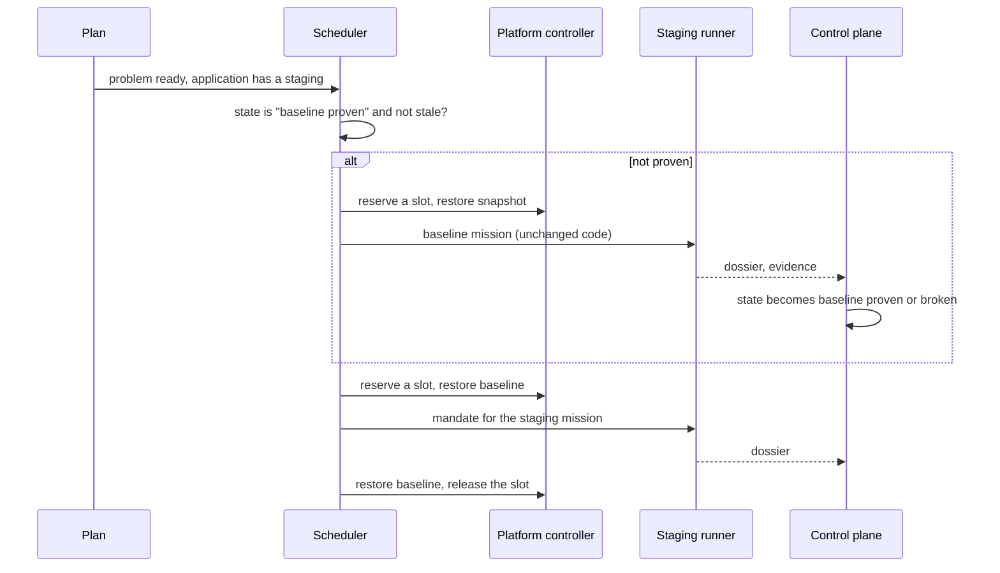

---

## 8. Security: where the frame is enforced

The principle of the maintainer: **the frame is enforced by the environment, never by the agent's good will.** [FR-SAF-2] The layers, from the outside in:

| Layer | What it enforces | Where |
|---|---|---|
| **The forge** | No push to a protected branch; code owners on the pipeline and quality files; the agent's identity cannot merge a change to a protected file; required checks | GitHub rulesets and code owners (infrastructure as code of the repositories) |
| **Credentials** | One repository, one world, short-lived, never visible to the agent beyond what the world needs; **no production secret in the agent's reach** | The runner and the control plane mint and hold them |
| **Mandate** | Which acts, which place, which budget, which expiry; signed | The control plane signs; the runner verifies |
| **The runner** | Isolation of the workspace (a container with no capability, not root, bounded resources), forbidden paths refused, network limited, a stop that kills the sandbox | The runner |
| **The act gateway** | Gated acts only if listed and preconditions hold | Runner and control plane |
| **Checks by code** | The preconditions of section 6 | Control plane |
| **The controller** | A second look, independent | Control plane |
| **The kill switch** | Stops every mission, revokes every mandate; unknown counts as stopped | Control plane, polled by every runner |
| **The audit trail** | Every mandate, refusal, act and decision, in an order that cannot be rewritten | Control plane, also shipped out of its host |

**Prompt injection** [FR-SAF-3]. What the agent reads (a pull request, a changelog, a repository) can try to steer it. The design assumes that **will happen**: nothing the agent reads can widen its frame, because the frame is not in its instructions. The credential that matters most, the model subscription token, is held outside the workspace and reaches the model provider only.

---

## 9. How a problem travels (sequences)

### End to end

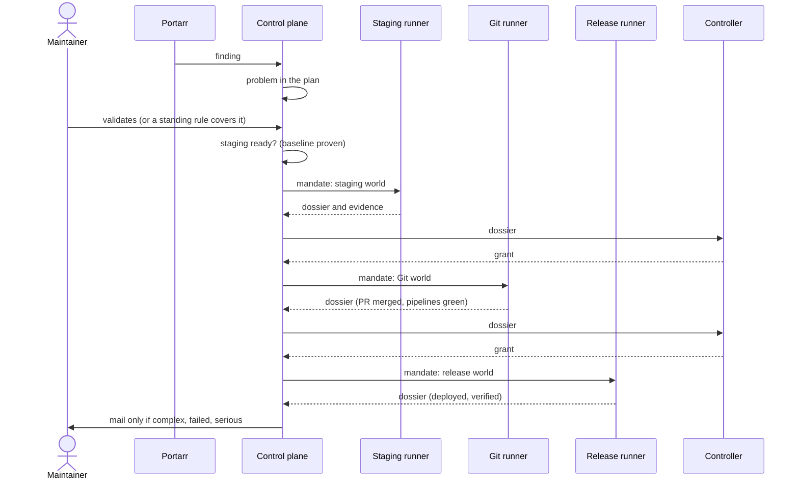

### A failure in production

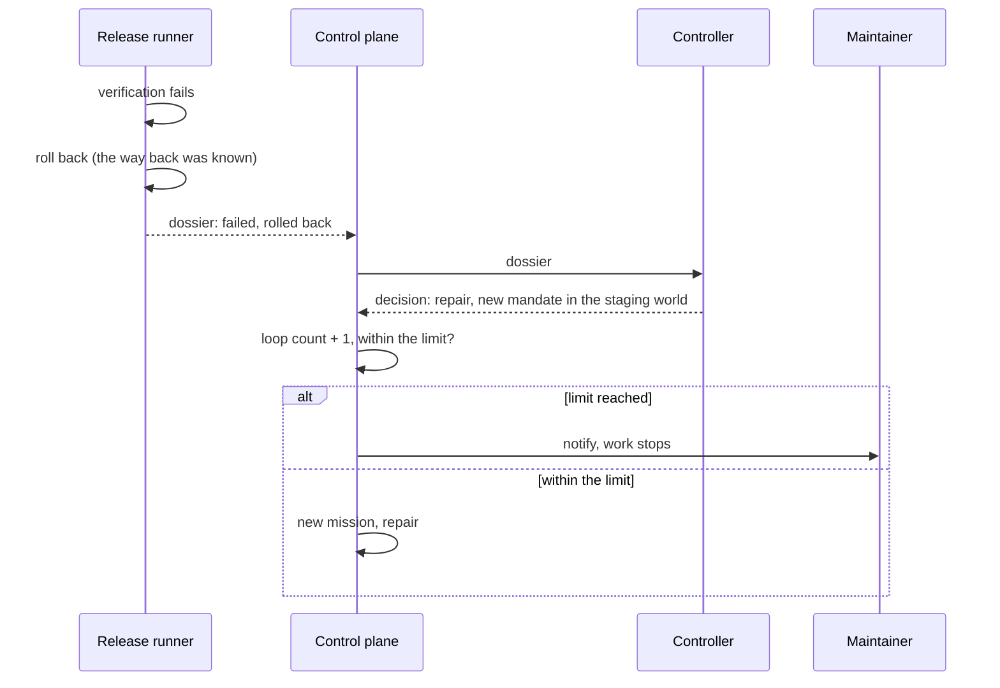

---

## 10. Where things run

| Piece | Where | Note |
|---|---|---|
| Control plane and its storage | An environment of the production fleet. **Orchestrarr's own repository, images and runners are outside its own perimeter** (or need the maintainer's merge): it never changes the product that holds its mandates [FR-SAF-11] | One container; the model provider and the mail are reached from it |
| Controller sandbox | A runner profile `controller` on a host independent of the worker runners, no tools, no network but the model provider (through the credential proxy) | Independent of the worker's runners |
| Staging runner | On the platform side of the laboratory machine, outside the staging virtual machines | The slots are configuration |
| Git runner (workshop) | A machine separate from production; at first the development host | **Open**: a dedicated workshop |
| Release runner | A machine with the connections that production environments are deployed through | **Open**: which machine, which credentials |
| Staging platform | A spare machine with a hypervisor (a few virtual machines, a small disk) | Constrains the number of stagings; the slot count is configuration |

---

## 11. Data and storage

- **Control plane**: one SQLite database (kept: the writer lock, the migrations). Tables for the plan, standing rules, problems, missions, mandates, dossiers and decisions, the staging catalogue and baselines, the audit trail, the accounts, the kill switch.
- **Dossiers and evidence** are **files** (the transcript, captures, request logs, test reports), addressed by their **digest**, stored beside the database; the database holds the digest and the metadata. What a controller decided on is exactly what can be shown afterwards. [FR-VER-3]
- **Runners** keep a small local store (their registration, the mandate being run, a cursor on the trace), never the long history.
- **The audit trail** is also written outside the host of the control plane, so that a compromised host cannot rewrite it. (Existing intention, kept.)
- **Retention**: **Open** (how long dossiers and traces are kept).

---

## 12. The screens and the API

**No new screen is invented here.** The existing ones are adapted, and the information they need is:

| Screen | Becomes |
|---|---|
| **Decisions** (the table) | **The plan**: problems, where each stands, how far it may go, priority |
| **Queue** (approvals) | **Mandates and approvals** waiting and running |
| **Runs** | **Missions in progress**: the world, the trace live, the evidence as it appears |
| **History** | What was done and decided, with dossiers and reports |
| **Activity** | The audit trail |
| **Status** | Sources, runners, the staging state per application, the kill switch |
| The bell | Notices (unreadable repositories, a broken staging, a loop that hit its limit) |

The **API** stays REST, first, and the live hub carries what changes (topics for the plan, missions, mandates, staging, notices). The routes follow the entities of section 4. **Open**: the detailed route list, written with the implementation.

---

## 13. Choices that remain open

1. **Where the worker and controller agents physically run**, and how the controller sandbox is kept independent from every runner.
2. **How the platform controller reaches the hypervisor**, and what exactly its token may do.
   **Configuration, not facts of the product**: the model of each agent role, the integration branch per repository, the number of staging slots.
3. **How a runner's identity is established** (the signature of a mandate is decided: asymmetric, ADR 0031).
4. **The mail path**: through Portarr or directly.
5. **How the rulesets and code owners of each repository are written as code**, and how the agent's identity is created (a GitHub App without the workflows permission, decided in ADR 0035).
6. **The description of the staging requirement**: where it is declared, who writes it.
7. **Retention** of dossiers, traces and evidence.
8. **The workshop and release hosts.**
