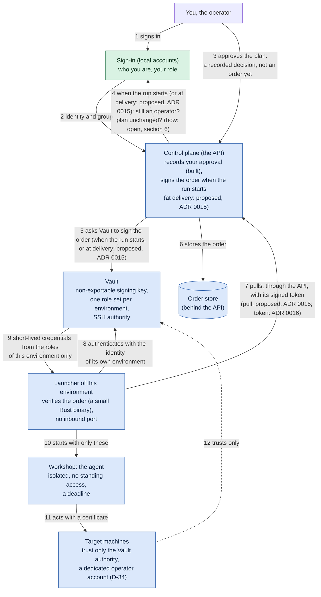
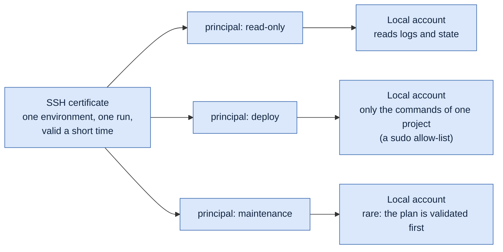
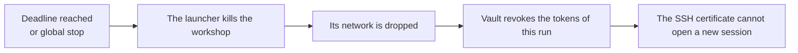

# How an order is secured, from the person to the machine

> **Status**: draft. It explains the mechanism proposed in [ADR 0006](adr/0006-a-launch-is-a-signed-order-and-credentials-are-short-lived.md) and [ADR 0007](adr/0007-a-dedicated-vault-and-a-small-control-plane.md) and settled by [ADR 0012](adr/0012-one-launcher-and-one-vault-role-per-environment.md) (these three are **proposed**, SPEC D-39 to D-57). Nothing that runs an agent is built yet. The launcher's language and its conformance vectors are decided in [ADR 0014](adr/0014-the-launcher-is-a-rust-binary-held-to-the-control-plane-by-shared-vectors.md) (D-59); how it gets its orders, the stop and the time is a proposal, [ADR 0015](adr/0015-where-the-launcher-gets-what-its-checks-read.md) (D-60); how it authenticates to the control plane, with a signed token of its own, and who runs an order with no environment are decided in [ADR 0016](adr/0016-the-launcher-acts-under-a-mandate-of-its-own.md) (D-62, D-63), on condition that the launcher pulls through the API (D-60, proposed).
> **Update of 2026-11-10 ([ADR 0017](adr/0017-orders-are-typed-tasks-approved-with-a-second-factor-that-the-executor-checks.md)).** The launcher of the diagrams below is now the **executor** (a .NET process per environment), and the server-signed order is replaced by a **batch of typed tasks approved with a one-time code that the executor checks itself**, against its own rights list and an approval journal kept apart from the queue. The executor is built as a dry run: it starts nothing. The Rust launcher, the conformance vectors and the signed-order library code of ADR 0014 to 0016 are gone. Read "launcher" and "signed order" below as the target design; the table of section 8 says what exists.
>
> **Defaults you can change**: ADR 0012 proposes, as the safe default, that a run gets a **tier** of the operator account (read-only, deploy, maintenance) instead of the whole account that SPEC D-34 and D-39 describe, and that the plan is validated before it is applied in production. The maintainer chose one launcher and one Vault role per environment.
>
> **Audience**: the maintainer and contributors. No real infrastructure value appears here: names are examples.

The security of an agent that can act does not live in its prompt. It lives in **who can cause a launch**, and in **what a launch is physically given**. A prompt is a sign on the door; the lock is the machine that refuses.

Two systems cooperate, and neither trusts the other's word:

- **The sign-in** (a local account, [ADR 0018](adr/0018-people-sign-in-with-local-accounts-and-permission-based-roles.md)) says **who the person is** and whether their role lets them give orders (the permission to approve); the proof of an approval is the second factor, which the executor checks (ADR 0017).
- **Vault** holds the **signing key of the orders** and issues the **short-lived credentials** that the machines accept. The agent never holds anything long-lived.

The agent is not authenticated by the identity provider. It is **given a badge** for one run, and the machines check the badge. In this document, the **workshop** is the isolated place where the agent runs (SPEC D-25).

## At a glance

- **No agent lives on your machines.** A target machine only keeps two things: trust in the signing authority of Vault (one public key in its SSH configuration) and a few accounts. Nothing resident, nothing running there between two runs.
- **An agent borrows access, it does not own any.** For one run it receives a certificate for one environment, valid for a short time. When the run ends, the access is gone. It never authenticates to Vault or to the control plane: the launcher hands it the credentials for its targets and nothing else (SPEC D-45).
- **Proposed by ADR 0012 (refines SPEC D-34 and D-42):** the strength of the agent is the strength of the local account the certificate opens, one tier per kind of run, set on the machine by you, so that the prompt cannot widen it.
- **Every order is signed, checked twice, and traced** from the person who approved it to the command that ran.

Contents: [the chain](#1-the-whole-chain) · [a run step by step](#2-one-run-step-by-step) · [a wild agent](#3-what-stops-a-wild-agent) · [how strong the badge is](#4-how-strong-the-badge-is) · [the deadline](#5-at-the-deadline-or-when-the-global-stop-engages) · [open questions](#6-open-questions) · [limits](#7-what-this-does-not-solve) · [what exists today](#8-what-exists-today)

## Legend

| Mark | Meaning |
|---|---|
| 🟢 | In `develop` today |
| 🔵 | Described in an ADR, proposed (0006, 0007, 0012, 0015) or decided (0014, 0016), not built |
| 🟣 | An idea under discussion, in no ADR yet: **not a commitment** until an ADR accepts it |

## 1. The whole chain



The colours show the main state of each box; the sentence below gives the exact state.

What is built (`🟢`): the sign-in with local accounts and roles ([ADR 0018](adr/0018-people-sign-in-with-local-accounts-and-permission-based-roles.md)), recording an approval, the audit trail and the global stop, and the executor as a dry run (typed tasks, the second factor, its rights list and the double control; it starts nothing). Everything else on the chain is `🔵`.

## 2. One run, step by step

```mermaid
sequenceDiagram
  autonumber
  actor P as You
  participant K as Sign-in (accounts)
  participant C as Control plane
  participant V as Vault
  participant L as Launcher
  participant W as Workshop, the agent
  participant T as Target machine

  P->>K: sign in (name and password)
  K-->>C: your account and your role
  P->>C: approve this plan, at this commit (recorded, no order yet)
  Note over C,L: later, when the run is about to start
  C->>K: is this person still an operator? (read from the database at every request)
  C->>C: kill switch off? power granted? commit unchanged? fresh second factor for production?
  C->>V: sign the order (the key never leaves Vault)
  L->>C: pull the signed order through the API (proposed, ADR 0015; the launcher has no inbound port)
  L->>L: signature valid? not expired? never used? within the granted powers?
  L->>V: authenticate as the launcher of this environment (its own workload identity)
  V-->>L: credentials from the roles of this environment, limited to this repository
  L->>W: start an isolated workshop with only those credentials and a deadline
  W->>T: connect with an SSH certificate (its identity carries the order id)
  T->>T: certificate signed by the Vault authority? still valid? right principal?
  W-->>L: result and diff
  L->>C: report, written in the audit trail (who, which order)
```

## 3. What stops a "wild agent"

An agent is never recognised by what it says. It is recognised by **what it holds**, and a credential is only issued against a valid order. A process started anywhere else holds nothing, and the machines refuse it.

| Attempt | What stops it | Who enforces it | State |
|---|---|---|---|
| Someone calls the API without being signed in | A session is required for every route | The host | 🟢 |
| A signed-in person who is not an operator approves | The permission `approvals.create` of the role is checked on the route, and the role is read from the database at every request | The host | 🟢 |
| A task written in the queue without an operator (a rogue line, a control plane taken over) | The executor checks the one-time code with a secret the control plane never holds, one use per time step, with a lockout; the batch must also be in the approval journal; its rights list refuses whatever the task says | The executor | 🟢 dry run (ADR 0017); the journal still shares the control plane's host (see ADR 0017, what the first slice settled) |
| A process asks Vault for credentials | Vault answers only to the workload identity of the launcher of that environment, and only from that environment's roles (a launcher of another environment gets nothing) | Vault | 🔵 |
| An agent started outside the workshop | It holds no certificate, so the machines refuse it | The target machines | 🔵 |
| A valid agent steps outside its environment | The certificate is valid for one environment and one run (SPEC D-42) | The target machines | 🔵 |
| A valid agent tries to do too much on its target | The account has the least privilege: no full `sudo`, a namespace-limited role, a one-repository token (narrower than D-34's operator account) | The target machines | 🔵 |
| An agent keeps running too long | The launcher kills the workshop, drops its network and revokes the tokens of the run (an SSH certificate cannot be revoked: it is short) | The launcher and Vault | 🔵 |
| Things go wrong everywhere | The global stop engages, which also cuts the run and revokes what can be revoked (ADR 0012) | The control plane and Vault | 🟢 the stop, 🔵 the rest |

## 4. How strong the badge is

> **ADR 0012 proposes this as the default.** SPEC D-34 and ADR 0006 already say that each environment has a dedicated operator account with the rights its projects need, and accept that these rights are high; D-39 says the agent is omnipotent within it; D-42 speaks of a single operator principal. Several principals and narrower accounts **refine D-34 and D-42 and temper D-39**: a run gets the tier it needs, not the whole operator account. Change it if you prefer the whole operator account.

The access of an agent would be set in two places, both on the target, never by the agent:

1. **Which door, and for how long.** The certificate says: this environment, this run, valid until this time.
2. **How much it can do once inside.** The certificate carries a *principal* (a name for what the run may be). The machine maps each principal to a local account of its own (OpenSSH does this with `AuthorizedPrincipalsFile`). Choosing the principal in the certificate is therefore choosing the strength of the agent.



The accounts would be created once on each machine, by you. The agent cannot widen them, and a prompt cannot either.

The same idea would apply to every channel the agent may use:

| Channel | Credential | What limits it |
|---|---|---|
| SSH to a machine | A certificate signed by the Vault SSH authority, valid minutes | The principal maps to a local account; a `sudo` allow-list, never full `sudo` |
| Kubernetes | A short-lived token | A role limited to one namespace |
| GitHub | An installation token, one repository, about an hour | The permissions of the app, and the branch rules of the repository |
| The model | The maintainer's subscription credential, read from Vault for the run (SPEC D-27, D-42): not a per-run credential | A budget in attempts and minutes (SPEC D-27) |

## 5. At the deadline, or when the global stop engages



An SSH certificate is checked **when a connection opens**, not afterwards: it is not a clock by itself, and Vault cannot revoke it, so it is kept to a few minutes. The clock is the launcher's. Cutting a connection does **not** undo a command already started on the target; a deployment that fails its checks is rolled back (SPEC D-08), and an action must be safe to repeat.

Time limits are meant to be **generous and configurable** (SPEC D-27 sets budgets and says that a run that hits its quota is paused and retried; ceilings per day and month are SPEC Q-09; extending a budget while a run is going is a new question 🟣). Running out of time should be a state of its own ("budget exhausted"), not a failure of the work. The limit bounds the window of risk; it does not prove that what was done is correct.

## 6. Open questions

Settled by [ADR 0012](adr/0012-one-launcher-and-one-vault-role-per-environment.md): Vault knows a launch is real by the **identity of the launcher of that environment**, with one set of Vault roles and one launcher per environment, so that a compromised launcher yields one environment. A single-use secret minted by the control plane is rejected: it would make the signer able to issue (SPEC D-45).

Still open:

- **How does the control plane know, at run start, that the person is still an operator?** Answered by ADR 0018: the role is read from the database at every request and the sessions are kept by the server, so a disabled account or a changed role applies at once. (The earlier weakness of a session that is a snapshot no longer exists.) 🟢
- **Who validates the plan for production**: one person with a step-up, or two (SPEC Q-21). Validating the plan itself is the default proposed by ADR 0012.
- **How is a budget extended while a run is going, and by whom?** SPEC Q-09 covers the ceilings only. 🟣

## 7. What this does not solve

- An agent that is misled can do **everything its badge opens**. The answer is small badges (section 4), short lifetimes and, for production, validation of the plan.
- A process inside the workshop shares the credentials of its run. The credentials of a run should therefore be as narrow as the order.

## 8. What exists today

| Piece | State |
|---|---|
| Approval recorded per pull request and commit, audit trail, global stop (in a SQLite file, [ADR 0013](adr/0013-approvals-the-trail-and-the-stop-are-kept-in-a-sqlite-file.md)) | 🟢 |
| Executor (.NET): typed tasks, second factor (TOTP) checked by the executor, rights list, double control against the journal, delegations, hash-chained trace and its timeline | 🟢 dry run, starts nothing |
| Sign-in with local accounts, roles, server-side sessions, CSRF header ([ADR 0018](adr/0018-people-sign-in-with-local-accounts-and-permission-based-roles.md)) | 🟢 |
| Vault dedicated to this purpose | 🔵 manifests in the GitOps repository, not initialised |
| Launcher that runs, order store, workshop, certificates, revoking the tokens of a run | 🔵 not built |
| The Rust launcher and the conformance vectors of ADR 0014 | ⛔ superseded by the .NET executor (ADR 0017) |
| The launcher pulling its orders through the control plane's API, with its own grants, its own list of production environments and an in-memory ledger; first a dry run | 🔵 proposed (ADR 0015, D-60), not built |
| The launcher of the home environment also serving the orders with no environment (a merge), with its own grants and forge role, in a namespace of its own | 🔵 decided, not built (ADR 0016, D-63) |
| The launcher authenticating to the API with a signed token of its own, one client per launcher, the key never leaving it (the token gives no access to Vault) | 🔵 decided, not built (ADR 0016, D-62) |
| One launcher and one Vault role set per environment, tiers of the operator account, validation of the plan for production | 🔵 proposed in ADR 0012 |
