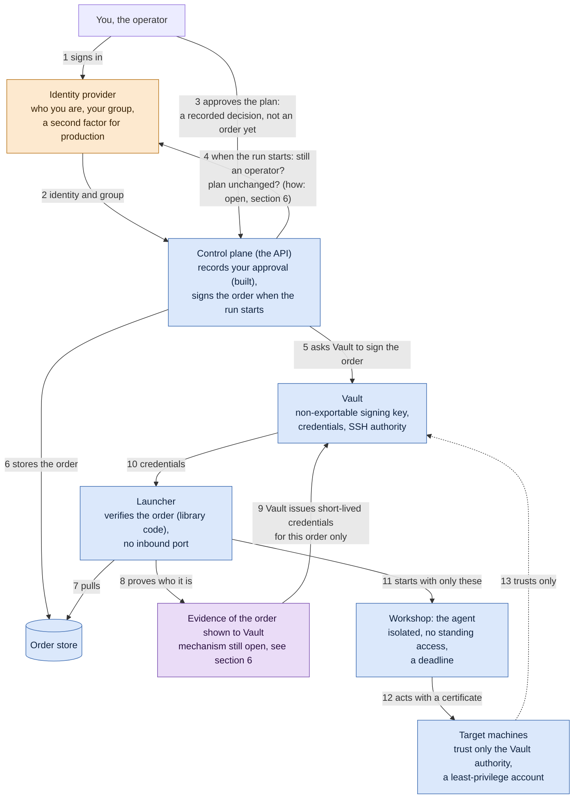
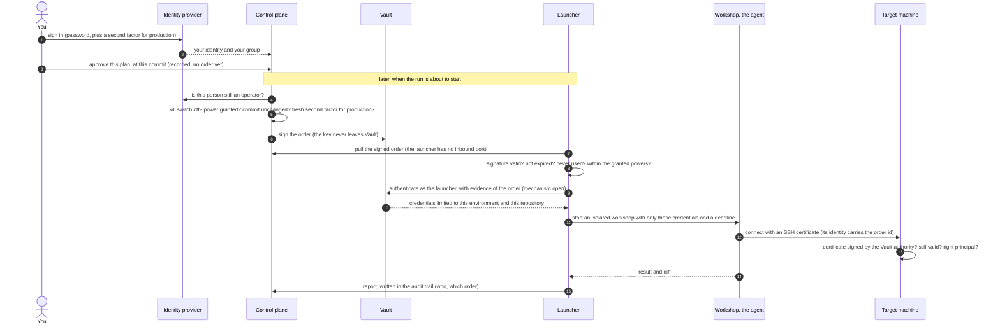
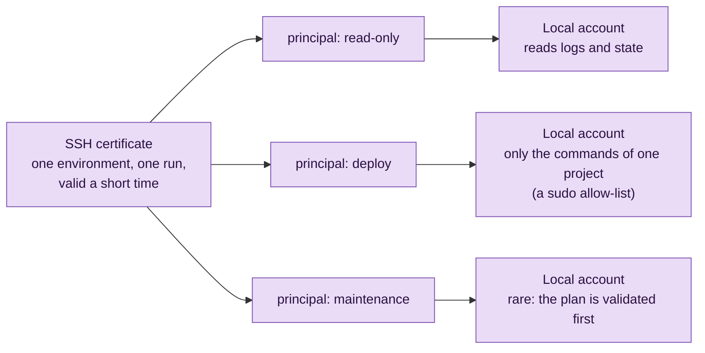

# How an order is secured, from the person to the machine

> **Status**: draft, to read before an ADR on the agent's credentials is written (the name "ADR 0012" is only a placeholder, nothing is reserved). It explains the mechanism proposed in [ADR 0006](adr/0006-a-launch-is-a-signed-order-and-credentials-are-short-lived.md) and [ADR 0007](adr/0007-a-dedicated-vault-and-a-small-control-plane.md) (both **proposed**, SPEC D-39 to D-48), and shows where new ideas under discussion would fit. Nothing that runs an agent is built yet.
>
> **A decision to take**: sections 3 (one row) and 4 propose that the agent runs under a **least-privilege account** chosen by the maintainer. SPEC D-39 says the opposite ("on its environment the agent is omnipotent") and D-42 speaks of one operator principal. Those parts are marked 🟣: they reverse D-39 and refine D-42 if the maintainer accepts them, and they are not a commitment until an ADR does.
>
> **Audience**: the maintainer and contributors. No real infrastructure value appears here: names are examples.

The security of an agent that can act does not live in its prompt. It lives in **who can cause a launch**, and in **what a launch is physically given**. A prompt is a sign on the door; the lock is the machine that refuses.

Two systems cooperate, and neither trusts the other's word:

- **The identity provider** (Keycloak in the reference setup) says **who the person is** and whether they may give orders (operator group, second factor for production).
- **Vault** holds the **signing key of the orders** and issues the **short-lived credentials** that the machines accept. The agent never holds anything long-lived.

The agent is not authenticated by the identity provider. It is **given a badge** for one run, and the machines check the badge. In this document, the **workshop** is the isolated place where the agent runs (SPEC D-25).

## At a glance

- **No agent lives on your machines.** A target machine only keeps two things: trust in the signing authority of Vault (one public key in its SSH configuration) and a few accounts. Nothing resident, nothing running there between two runs.
- **An agent borrows access, it does not own any.** For one run it receives a certificate for one environment, valid for a short time. When the run ends, the access is gone. It never authenticates to Vault or to the control plane: the launcher hands it the credentials for its targets and nothing else (SPEC D-45).
- **Proposed (🟣, reverses SPEC D-39):** the strength of the agent is the strength of the local account the certificate opens, set on the machine by you, so that the prompt cannot widen it.
- **Every order is signed, checked twice, and traced** from the person who approved it to the command that ran.

Contents: [the chain](#1-the-whole-chain) · [a run step by step](#2-one-run-step-by-step) · [a wild agent](#3-what-stops-a-wild-agent) · [how strong the badge is](#4-how-strong-the-badge-is) · [the deadline](#5-at-the-deadline-or-when-the-global-stop-engages) · [open questions](#6-open-questions) · [limits](#7-what-this-does-not-solve) · [what exists today](#8-what-exists-today)

## Legend

| Mark | Meaning |
|---|---|
| 🟢 | In `develop` today |
| 🟠 | In an open pull request (the sign-in with the identity provider, #17) |
| 🔵 | Described in a proposed ADR (0006, 0007), not built |
| 🟣 | An idea under discussion, in no ADR yet, or one that **contradicts** a recorded decision: **not a commitment** until an ADR accepts it |

## 1. The whole chain

What is built (`🟢`): recording an approval, the audit trail and the global stop, and, as library code that no process runs yet, the signed order and the launcher's checks. The sign-in is `🟠` (open pull request). Everything else on the chain is `🔵`, and the evidence shown to Vault is `🟣`.

## 2. One run, step by step

## 3. What stops a "wild agent"

An agent is never recognised by what it says. It is recognised by **what it holds**, and a credential is only issued against a valid order. A process started anywhere else holds nothing, and the machines refuse it.

| Attempt | What stops it | Who enforces it | State |
|---|---|---|---|
| Someone calls the API without being signed in | A session is required for every route | The host | 🟠 |
| A signed-in person who is not an operator approves | The operator group is checked | The host | 🟠 |
| A forged or replayed order | The signature, the expiry and a one-time number are checked | The launcher | 🟢 library code, 🔵 not running |
| A process asks Vault for credentials | Vault answers only to the launcher's identity, and only with evidence of a real order | Vault | 🔵 the identity, 🟣 the evidence |
| An agent started outside the workshop | It holds no certificate, so the machines refuse it | The target machines | 🔵 |
| A valid agent steps outside its environment | The certificate is valid for one environment and one run (SPEC D-42) | The target machines | 🔵 |
| A valid agent tries to do too much on its target | The account has the least privilege: no full `sudo`, a namespace-limited role, a one-repository token (**reverses D-39**) | The target machines | 🟣 |
| An agent keeps running too long | The launcher kills the workshop, drops its network and revokes its leases | The launcher and Vault | 🔵 |
| Things go wrong everywhere | The global stop engages, which also revokes the leases (ADR 0006, D-43) | The control plane and Vault | 🟢 the stop, 🔵 the revocation |

## 4. How strong the badge is (proposal 🟣)

> **This section is a proposal.** SPEC D-39 says that on its environment the agent is omnipotent, and D-42 speaks of a single operator principal. Several principals and least-privilege accounts would **reverse D-39 and refine D-42**. It is shown because it is the safer reading, and it needs the maintainer's decision.

The access of an agent would be set in two places, both on the target, never by the agent:

1. **Which door, and for how long.** The certificate says: this environment, this run, valid until this time.
2. **How much it can do once inside.** The certificate carries a *principal* (a name for what the run may be). The machine maps each principal to a local account of its own (OpenSSH does this with `AuthorizedPrincipalsFile`). Choosing the principal in the certificate is therefore choosing the strength of the agent.

The accounts would be created once on each machine, by you. The agent cannot widen them, and a prompt cannot either.

The same idea would apply to every channel the agent may use:

| Channel | Credential | What limits it |
|---|---|---|
| SSH to a machine | A certificate signed by the Vault SSH authority, valid minutes | The principal maps to a local account; a `sudo` allow-list, never full `sudo` |
| Kubernetes | A short-lived token | A role limited to one namespace |
| GitHub | An installation token, one repository, about an hour | The permissions of the app, and the branch rules of the repository |
| The model | A credential issued for the run (SPEC D-42) | A budget in attempts and minutes (SPEC D-27) |

## 5. At the deadline, or when the global stop engages

An SSH certificate is checked **when a connection opens**, not afterwards: it is not a clock by itself. The clock is the launcher's. Cutting a connection does **not** undo a command already started on the target; a deployment that fails its checks is rolled back (SPEC D-08), and an action must be safe to repeat.

Time limits are meant to be **generous and configurable** (SPEC D-27 sets budgets; how they are extended, and by whom, is open, SPEC Q-09). Running out of time should be a state of its own ("budget exhausted"), not a failure of the work. The limit bounds the window of risk; it does not prove that what was done is correct.

## 6. Open questions

- **How does Vault know a launch is real?** The principle: Vault issues credentials only to the launcher's own identity (a workload identity, such as a Kubernetes service account or an AppRole bound to its pod) and only against evidence of a valid order. The mechanism is not chosen. Vault's open-source edition cannot check the signature of an order by itself. Options: a small gate that verifies the order and asks Vault with its own identity; or one Vault role per environment, so that the launcher can only obtain credentials for the environments it serves. A single-use secret minted by the control plane when it signs would bind credentials to one order, but it would make the control plane issue a credential, which SPEC D-45 forbids: whoever signs must not be able to execute. 🟣
- **How does the control plane know, at run start, that the person is still an operator?** ADR 0010 says it asks the identity provider again, but nobody's session is live then. Options: keep a refresh token on the server, ask the provider's admin interface, or keep a server-side session store that can revoke. It also closes the weakness of section 7. 🔵
- **Is the agent limited to a least-privilege account, as section 4 proposes, or omnipotent on its environment, as D-39 says?** A decision of the maintainer; the answer shapes what each target machine must prepare. 🟣
- **Validating the plan.** For production, should the person validate the plan (the diff) before it is applied, in addition to the launch? It changes who approves production (SPEC Q-21, open). 🟣

## 7. What this does not solve

- An agent that is misled can do **everything its badge opens**. The answer would be small badges (🟣, section 4), short lifetimes and, for production, validation of the plan.
- A process inside the workshop shares the credentials of its run. The credentials of a run should therefore be as narrow as the order.
- A person's session is a snapshot of their groups: someone removed from the operator group keeps their rights until the session ends. It gives no power today, since nothing runs, and it must be closed before a launcher exists (by the check in step 4 of section 1, or by a session store that can revoke).

## 8. What exists today

| Piece | State |
|---|---|
| Approval recorded per pull request and commit, audit trail, global stop (in memory) | 🟢 |
| Signed order, issuer, launcher checks, one-time number and refusal codes (library code, tested, not run by any process) | 🟢 |
| Sign-in with the identity provider, operator group, origin check | 🟠 |
| Vault dedicated to this purpose | 🔵 manifests in the GitOps repository, not initialised |
| Launcher that runs, order store, workshop, certificates, revoking leases | 🔵 not built |
| Evidence of the order shown to Vault, validation of the plan for production, least-privilege accounts per principal | 🟣 under discussion |
