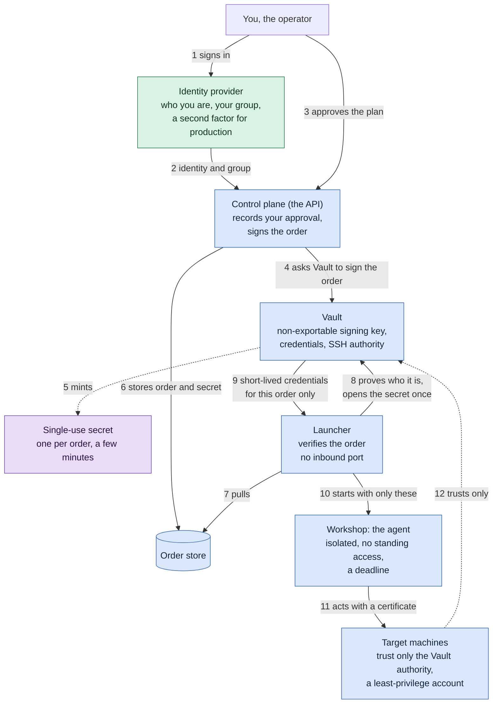
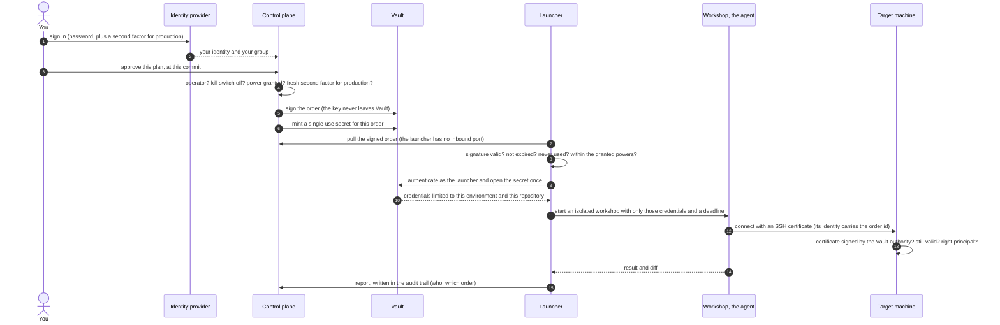
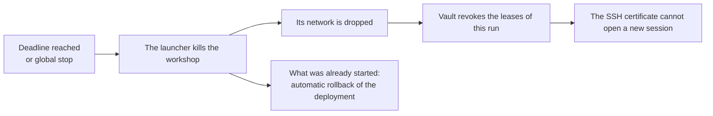

# How an order is secured, from the person to the machine

> **Status**: draft, to read before ADR 0012 is written. It explains the mechanism of [ADR 0006](adr/0006-a-launch-is-a-signed-order-and-credentials-are-short-lived.md) and [ADR 0007](adr/0007-a-dedicated-vault-and-a-small-control-plane.md) (decided), and shows where the proposals under discussion fit. Nothing on the right of the sign-in runs yet.
>
> **Audience**: the maintainer and contributors. No real infrastructure value appears here: names are examples.

The security of an agent that can act does not live in its prompt. It lives in **who can cause a launch**, and in **what a launch is physically given**. A prompt is a sign on the door; the lock is the machine that refuses.

Two systems cooperate, and neither trusts the other's word:

- **The identity provider** (Keycloak in the reference setup) says **who the person is** and whether they may give orders (operator group, second factor for production).
- **Vault** holds the **signing key of the orders** and issues the **short-lived credentials** that the machines accept. The agent never holds anything long-lived.

The agent is not authenticated by the identity provider. It is **given a badge** for one run, and the machines check the badge.

## Legend

| Mark | Meaning |
|---|---|
| 🟢 | In the code today |
| 🔵 | Decided in an ADR, not built |
| 🟣 | Proposed, waiting for the maintainer's go (ADR 0012) |

## 1. The whole chain

`🟢` The sign-in with the identity provider and the recording of an approval are built. `🔵` The signed order, the launcher that only verifies, and the credentials issued by Vault are decided. `🟣` The single-use secret, and the launcher proving its own identity to Vault, are proposed.

## 2. One run, step by step

## 3. What stops a "wild agent"

An agent is never recognised by what it says. It is recognised by **what it holds**, and a credential is only issued against a valid order. A process started anywhere else holds nothing, and the machines refuse it.

| Attempt | What stops it | Who enforces it |
|---|---|---|
| Someone calls the API without being signed in | A session is required for every route | The host |
| A signed-in person who is not an operator approves | The operator group is checked | The host |
| A forged or replayed order | The signature, the expiry and a one-time number are checked | The launcher |
| A process asks Vault for credentials | Vault answers only to the launcher's identity, and only with the single-use secret of a real order 🟣 | Vault |
| An agent started outside the workshop | It holds no certificate, so the machines refuse it | The target machines |
| A valid agent steps outside its environment | The certificate is valid for one environment, one principal, one run | The target machines |
| A valid agent tries to do too much on its target | The account has the least privilege: no full `sudo`, a namespace-limited role, a one-repository token | The target machines |
| An agent keeps running too long | The launcher kills the workshop, drops its network and revokes its leases | The launcher and Vault |
| Things go wrong everywhere | The global stop engages, and also revokes the leases 🟣 | The control plane and Vault |

## 4. At the deadline, or when the global stop engages

An SSH certificate is checked **when a connection opens**, not afterwards: it is not a clock by itself. The clock is the launcher's. Cutting a connection does not undo a command already started on the target, which is why a deployment has an automatic rollback.

Time limits are **generous and configurable**. Running out of time is a state of its own ("budget exhausted"), not a failure of the work, and a long step can be extended. The limit bounds the window of risk; it does not prove that what was done is correct.

## 5. What this does not solve

- An agent that is misled can do **everything its badge opens**. The answer is small badges, short lifetimes, and, for production, your validation of the **plan** (the diff) and not only of the launch.
- A process inside the workshop shares the credentials of its run. The credentials of a run are therefore as narrow as the order.
- A session of a person is a snapshot: a person removed from the operator group keeps their rights until the session ends. It gives no power today, since nothing runs; it must be closed before a launcher exists ([ADR 0011](adr/0011-people-sign-in-through-the-identity-provider.md)).

## 6. What exists today

| Piece | State |
|---|---|
| Sign-in with the identity provider, operator group, origin check | 🟢 in a pull request waiting for validation |
| Approval recorded per pull request and commit, audit trail, global stop (in memory) | 🟢 |
| Signed order, issuer, launcher checks, nonce and refusal codes (library code, tested) | 🟢 |
| Vault deployed for this purpose | 🔵 deployment manifests exist, not initialised |
| Launcher that runs, order store, workshop | 🔵 not built |
| Single-use secret per order, launcher identity to Vault, revoking leases on stop, validation of the plan for production | 🟣 proposed |
